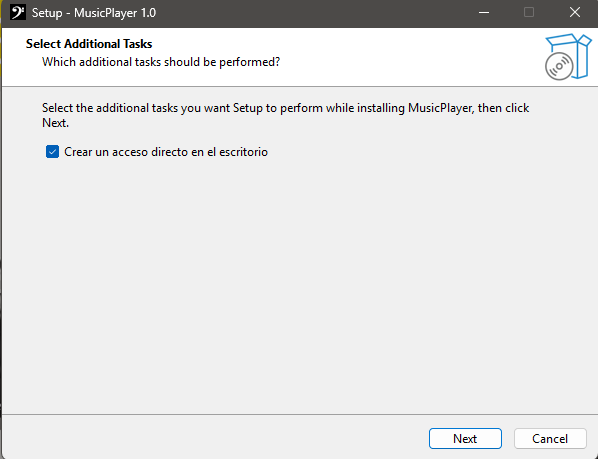
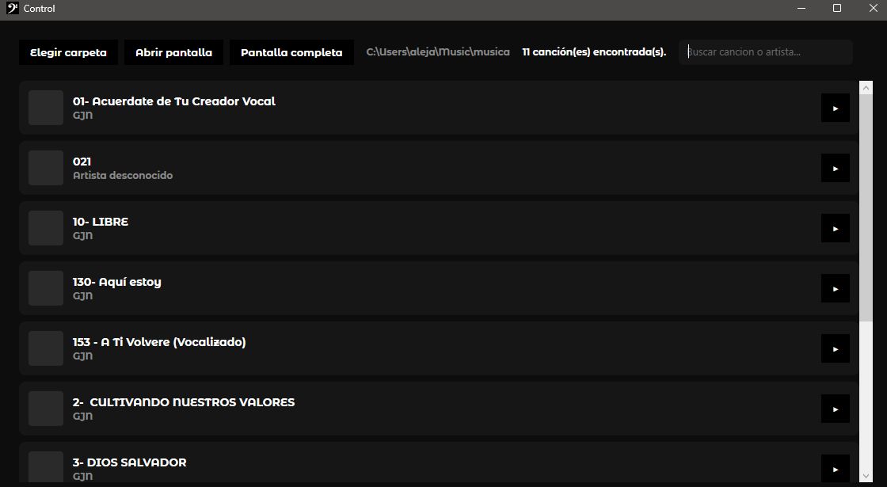
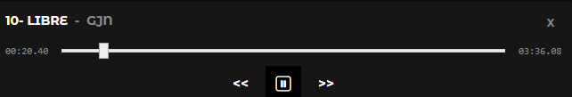
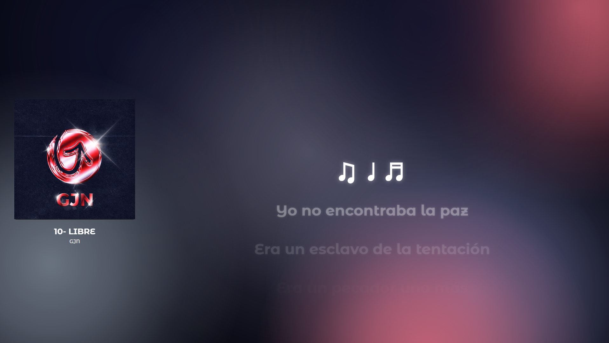

# Reproductor de música

Reproductor de escritorio para Windows, hecho en WPF sobre .NET 10. Reproduce canciones locales (`.mp3`) con letra sincronizada (`.lrc`) y
un fondo animado con los colores dominantes de la carátula.

## Requisitos

- Windows 10/11
- Arquitectura x64 (64 bits)

## Instructivo de instalación

1. Ejecutar `Instalador_MusicPlayer.exe`, presionar el botón *Siguiente* y seleccionar el recuadro para crear un acceso directo en el escritorio.

<br>

---
<br>
<br>
<p align="center">
  
</p>

---
<br>


## Instructivo de ejecución y uso

Al iniciar el programa, se despliegan dos ventanas:

- Ventana de control
- Ventana de visualización

### Ventana de control

Esta ventana posee distintas funcionalidades:

<br>

---

<br>
<p align="center">
  
</p>
<br>

---
<br>

1. **Seleccionar carpeta:** accede al explorador de archivos para seleccionar la carpeta donde están los `archivos.mp3` junto con los `archivos.lrc`.

2. **Lista de pistas:** al cargar una carpeta se despliegan todas las pistas encontradas. Con el botón de *play* podemos iniciar la reproducción de la alabanza.

3. **Controles del reproductor:** al iniciar una alabanza aparecerá un recuadro en la parte inferior que nos da la opción de pausar y reanudar la pista, así como la de saltar a la siguiente o regresar a la anterior. El reproductor muestra una barra de progreso junto a un reloj que indica el tiempo transcurrido de la canción. Si arrastramos esa barra, podemos situarnos en cualquier parte de la canción y la letra también se actualizará.

<br>

---
<br>

<p align="center">
  
</p>
<br>

---
<br>

4. **Abrir pantalla:** si por algún motivo no se abre automáticamente la pantalla de visualización o se cierra accidentalmente, podemos reabrirla con este botón.

5. **Pantalla completa:** para mayor comodidad, se incorpora este botón que fuerza la pantalla completa sin tener que tocar nada de la segunda pantalla.

6. **Buscar:** podemos buscar por título o nombre en la barra de búsqueda desplegable.


### Ventana de visualización

En este apartado tendremos dos columnas: en una se mostrará la `carátula` del `álbum`, el `título` y el `artista`. El fondo tomará los colores dominantes de cada `carátula` y los textos de `título` y `artista`, al ser muy extensos, se mostrarán en forma de carrusel, desplazándose de derecha a izquierda.

<br>

---
<br>
<p align="center">
  
</p>

<br>

---
<br>

## Funcionamiento del programa

El programa depende de dos elementos principales: los `archivos.mp3` y los `archivos.lrc`. Su funcionamiento se basa en una expresión regular, por lo que el formato del `archivo.lrc` debe seguirse a cabalidad.

### Formato del archivo .lrc

Cada línea lleva el tiempo entre corchetes, seguido del texto:

```
[00:12.30] Ejemplo para el archivo.lrc
[00:16.80] Se ajusta el tiempo de aparición
[00:21.10] Minutos, segundos y milésimas de segundo
```

Dentro del programa se ejecuta un `TimeStamp` que sincroniza el tiempo de la pista con el texto que aparecerá en pantalla, dividiéndose en tres posibles estados: letra actual, letra pasada y letra futura, cada una con distinto tamaño, color y opacidad, lo que da un efecto de fluidez al transicionar entre ellas.

## Nota

El programa solo trabaja con `archivos.mp3`; no acepta otras extensiones. Esta decisión fue tomada para aligerar el peso y los requisitos de los equipos donde será ejecutado.